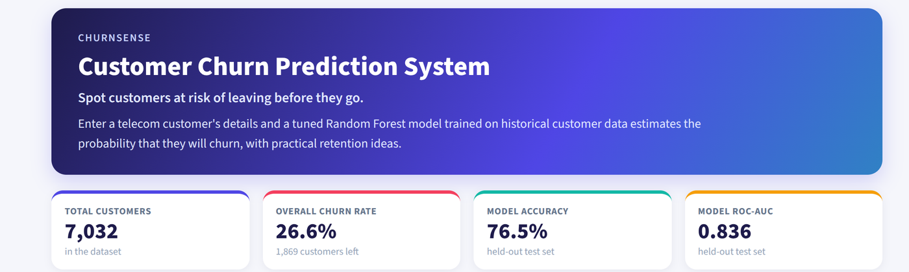
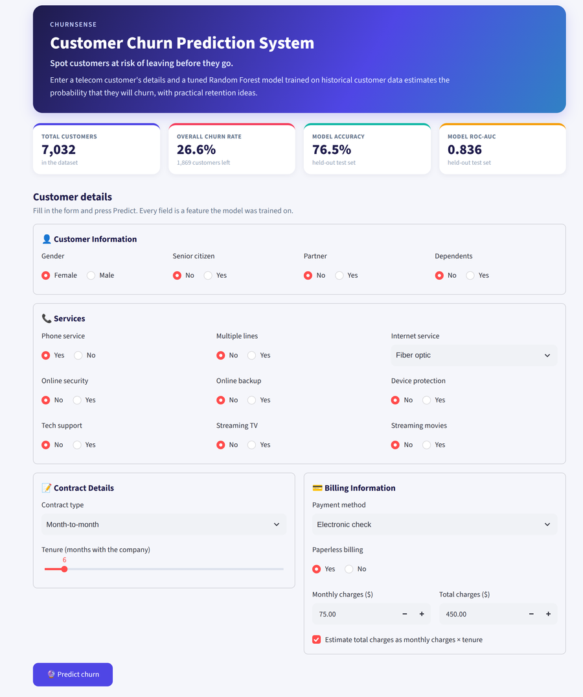
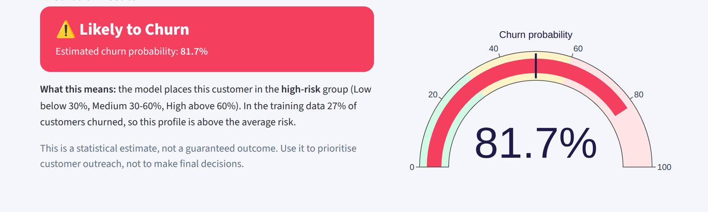
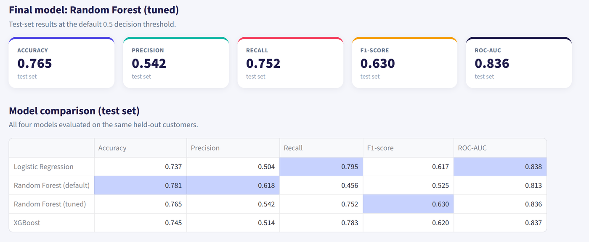
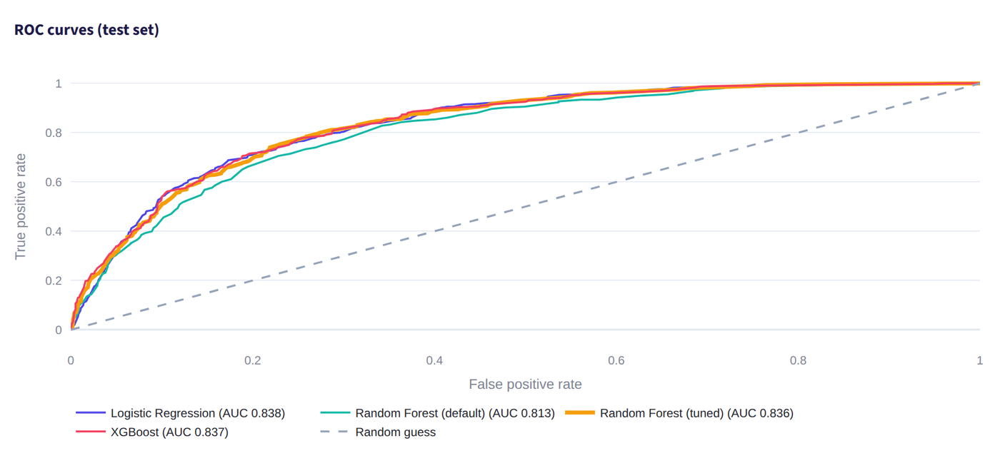
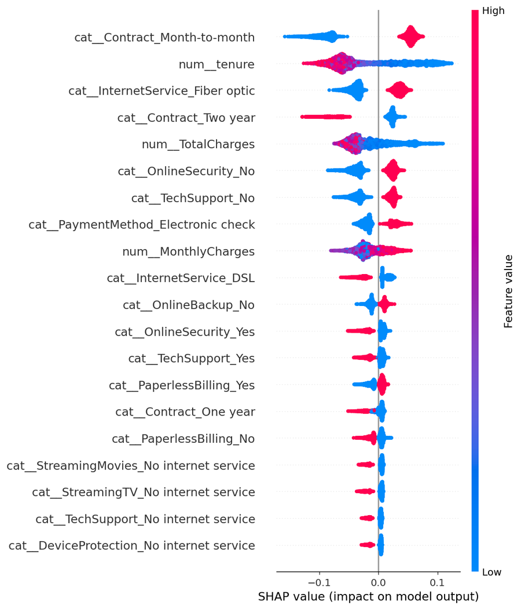
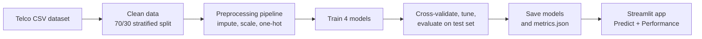

<div align="center">

# 📉 ChurnSense
### Customer Churn Prediction System

Predict which telecom customers are likely to leave, understand why, and act before they do.

[](https://churnsense-mlprediction.streamlit.app/)




</div>

---

## Table of Contents
- [Overview](#overview)
- [Key Features](#key-features)
- [Screenshots](#screenshots)
- [Results at a Glance](#results-at-a-glance)
- [How It Works](#how-it-works)
- [Dataset](#dataset)
- [Machine Learning Workflow](#machine-learning-workflow)
- [Model Comparison](#model-comparison)
- [Tech Stack](#tech-stack)
- [Project Structure](#project-structure)
- [Getting Started](#getting-started)
- [Using the App](#using-the-app)
- [Limitations](#limitations)
- [Future Improvements](#future-improvements)
- [Author](#author)

---

## Overview

**Customer churn** happens when a customer stops using a company's service. In telecom, winning a new customer usually costs more than keeping an existing one, so knowing *who is likely to leave* early is valuable.

**ChurnSense** is an end-to-end machine learning project that:

1. learns churn patterns from historical telecom customer data,
2. predicts the **probability of churn** for a new customer,
3. classifies the customer into a **Low / Medium / High risk** group, and
4. suggests practical **retention actions**,

all through a clean two-page Streamlit web app.

> ⚠️ Predictions are statistical estimates, not guarantees. Use them to prioritise outreach, not to make final decisions about individual customers.

## Key Features

- 🔮 **Instant churn prediction** from 19 customer attributes, with a churn probability and a visual gauge
- 🚦 **Risk grouping**: Low (< 30%), Medium (30-60%), High (> 60%)
- 💡 **Retention suggestions** tailored to the customer's contract, tenure, payment method and services
- 📊 **Model Performance dashboard**: metric comparison, confusion matrix, classification report, ROC curves
- 🔍 **Explainability**: Random Forest feature importance and SHAP summary and bar plots
- 🎚️ **Threshold analysis** showing the precision / recall trade-off, plus risk-level distribution
- ♻️ **Reproducible training** with a fixed random seed; every number on the site is read from `models/metrics.json` (nothing is hardcoded)

## Screenshots

| Customer input form | Prediction result |
|:---:|:---:|
|  |  |

| Model performance dashboard | ROC curves |
|:---:|:---:|
|  |  |

<div align="center">
<br>
<sub>SHAP summary plot for the final Random Forest model</sub>
</div>

## Results at a Glance

Final model: **Random Forest (tuned)**, evaluated on a held-out test set of 2,110 customers.

| Accuracy | Precision | Recall | F1-score | ROC-AUC |
|:---:|:---:|:---:|:---:|:---:|
| **0.765** | **0.542** | **0.752** | **0.630** | **0.836** |

On the test set the model correctly caught 422 of the 561 customers who actually churned (recall about 75%), at the cost of 356 false alarms. Recall is prioritised over raw accuracy because missing a churner is usually more costly than contacting a customer who would have stayed.

## How It Works



**Prediction logic in the app:** the form values become a one-row table with exactly the 19 features used in training. The saved pipeline applies the same preprocessing and returns a label (`predict`) and a churn probability (`predict_proba`).

## Dataset

- **Source:** Telco Customer Churn dataset (IBM sample data), stored in `data/telecomechurn.csv`
- **Size:** 7,043 raw rows; **7,032 customers** after removing 11 rows with a blank `TotalCharges`
- **Target:** `Churn` (Yes / No): 1,869 churned customers (**26.6%**), so the classes are imbalanced
- **Features (19):**
  - *Numeric (3):* `tenure`, `MonthlyCharges`, `TotalCharges`
  - *Categorical (16):* `gender`, `SeniorCitizen`, `Partner`, `Dependents`, `PhoneService`, `MultipleLines`, `InternetService`, `OnlineSecurity`, `OnlineBackup`, `DeviceProtection`, `TechSupport`, `StreamingTV`, `StreamingMovies`, `Contract`, `PaperlessBilling`, `PaymentMethod`

## Machine Learning Workflow

1. **Load and clean:** convert `TotalCharges` to numbers and drop the 11 invalid rows.
2. **Split:** stratified 70% train (4,922) / 30% test (2,110), `random_state=42`.
3. **Preprocess (inside a scikit-learn `Pipeline`, fitted on training data only):**
   - numeric: median imputation + `StandardScaler`
   - categorical: most-frequent imputation + `OneHotEncoder`
4. **Handle imbalance:** balanced class weights (Logistic Regression, Random Forest) and `scale_pos_weight` (XGBoost).
5. **Train four models:** Logistic Regression, Random Forest (default), Random Forest (tuned), XGBoost.
6. **Tune:** `GridSearchCV` on the Random Forest (24 combinations x 3 folds = 72 fits, scored by ROC-AUC).
   Best parameters: `max_depth=10`, `min_samples_leaf=5`, `min_samples_split=2`, `n_estimators=200`.
7. **Validate:** 5-fold cross-validation (Logistic Regression and default Random Forest) on training data only.
8. **Evaluate:** accuracy, precision, recall, F1, ROC-AUC, confusion matrix, classification report, ROC curves, feature importance, threshold analysis, risk levels and SHAP.
9. **Save:** trained pipelines with Joblib, all metrics to `models/metrics.json`.

## Model Comparison

Test-set results (cross-validation uses training data only):

| Model | Accuracy | Precision | Recall | F1 | ROC-AUC | CV ROC-AUC |
|---|:---:|:---:|:---:|:---:|:---:|:---:|
| Logistic Regression | 0.737 | 0.504 | **0.795** | 0.617 | **0.838** | 0.848 (5-fold) |
| Random Forest (default) | **0.781** | **0.618** | 0.456 | 0.525 | 0.813 | 0.823 (5-fold) |
| **Random Forest (tuned)** ⭐ | 0.765 | 0.542 | 0.752 | **0.630** | 0.836 | 0.846 (3-fold) |
| XGBoost | 0.745 | 0.514 | 0.783 | 0.620 | 0.837 | not run |

Bold marks the best value in each column. The tuned Random Forest is the final model used for predictions: it has the best F1-score and a good balance of recall and precision. It is **not** best on every metric, and the top three models are within about 0.002 ROC-AUC of each other, so the differences are small.

## Tech Stack

| Area | Tools |
|---|---|
| Language | Python |
| Data | Pandas, NumPy |
| Machine learning | Scikit-learn (pipelines, Logistic Regression, Random Forest, GridSearchCV), XGBoost |
| Explainability | SHAP, Matplotlib |
| Web app and charts | Streamlit, Plotly |
| Model persistence | Joblib |

## Project Structure

```
churnsense/
├── app.py              # Streamlit app (Predict Churn + Model Performance)
├── train_model.py      # Full training and evaluation pipeline
├── churn_utils.py      # Shared paths, feature lists, data cleaning
├── requirements.txt
├── README.md
├── data/
│   └── telecomechurn.csv
├── models/             # Generated by train_model.py
│   ├── rf_model.pkl        # Final tuned Random Forest (used by the app)
│   ├── logistic_model.pkl
│   ├── xgb_model.pkl
│   ├── metrics.json        # Every metric shown on the Performance page
│   ├── shap_summary.png
│   └── shap_bar.png
└── assets/             # README screenshots
```

## Getting Started

**Prerequisites:** Python 3.9 or newer (developed and tested with Python 3.12).

### 1. Clone and create a virtual environment

**Windows (PowerShell)**
```powershell
git clone <your-repository-url>
cd <repository-folder>
python -m venv venv
.\venv\Scripts\Activate.ps1
pip install -r requirements.txt
```
If PowerShell blocks activation, run once: `Set-ExecutionPolicy -Scope CurrentUser RemoteSigned`

**macOS / Linux**
```bash
git clone <your-repository-url>
cd <repository-folder>
python3 -m venv venv
source venv/bin/activate
pip install -r requirements.txt
```

### 2. Train the models
```bash
python train_model.py
```
Takes roughly 2-5 minutes (GridSearchCV + SHAP). This creates the `models/` files. Re-run it if your scikit-learn version differs from the one that produced the saved models.

### 3. Launch the app
```bash
streamlit run app.py
```
Open http://localhost:8501 in your browser.

## Using the App

**🔮 Predict Churn**
1. Fill in the customer details (customer info, services, contract, billing).
2. Click **Predict churn**.
3. Read the result: *Likely to Churn / Likely to Stay*, the probability gauge, the risk group, notable factors and retention suggestions.

**📈 Model Performance**
Compare all four models, inspect the confusion matrix and classification report, view ROC curves, feature importance and SHAP plots, and explore how the decision threshold changes precision and recall.

## Limitations

- Trained on a single dataset snapshot from one company, so it may not generalise to other markets.
- The final model's precision is moderate (0.542): roughly half of the customers it flags would not have churned.
- No usage-behaviour or customer-service history is available.
- Feature importance and SHAP show association, not proof of cause.
- The app predicts with the default 0.5 decision rule; the best threshold depends on business costs.

## Future Improvements

- Choose the decision threshold using retention-offer cost versus customer lifetime value
- Per-customer SHAP explanations in the prediction result
- Batch prediction: upload a CSV and download risk scores
- Probability calibration and model monitoring
- Larger, more recent data, REST API and CRM integration

## Author

**[Lucky Khatri]**, B.Tech Information Technology, [Guru Nanak Dev Engineering College]
